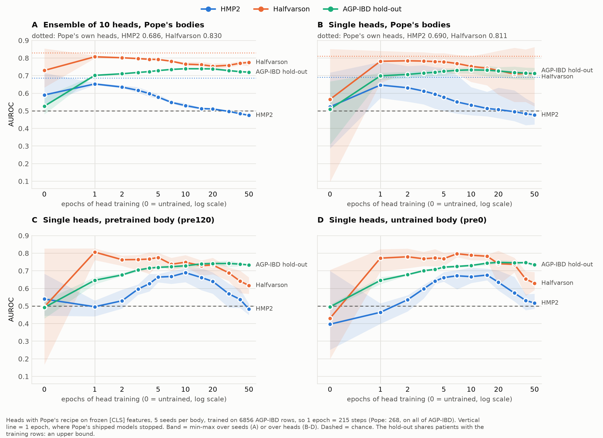
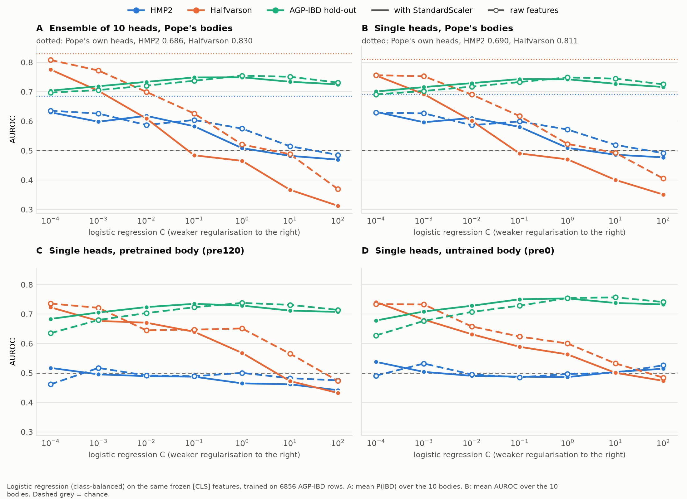
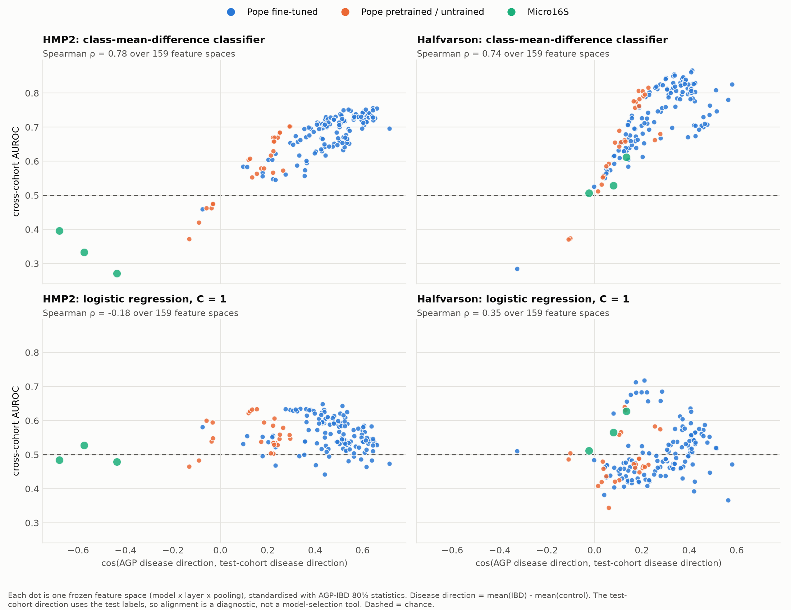
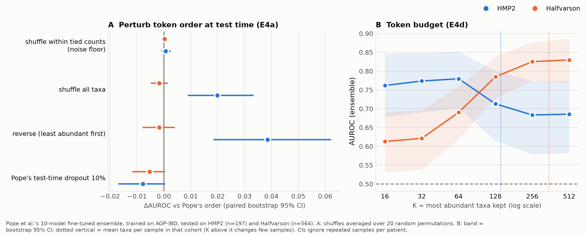
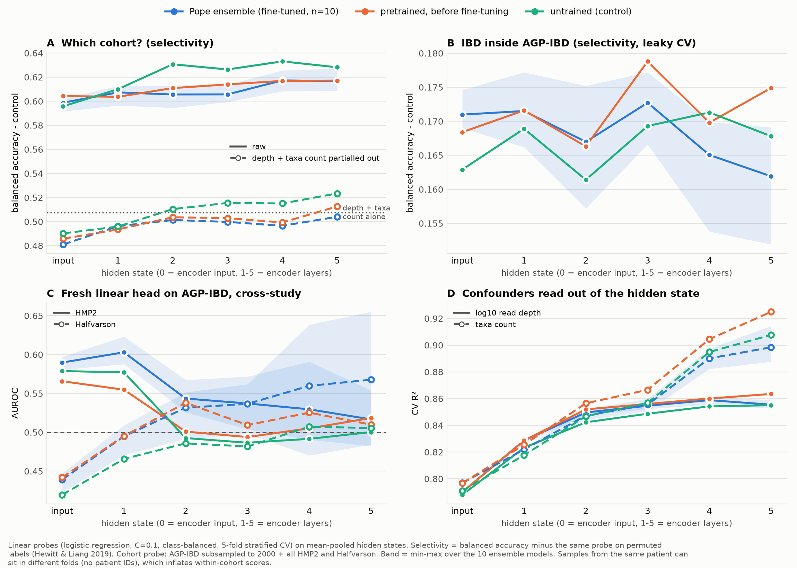
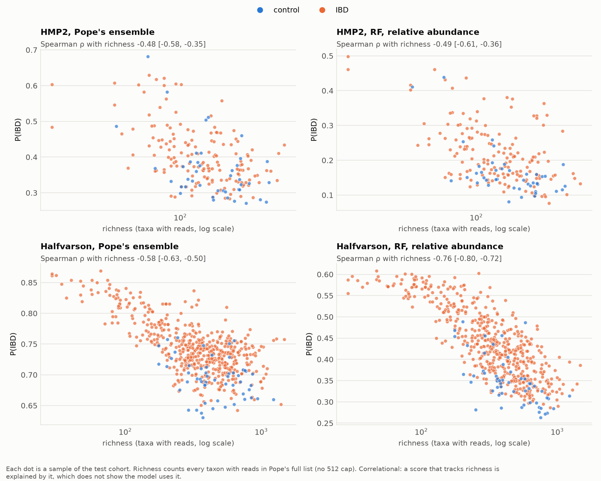
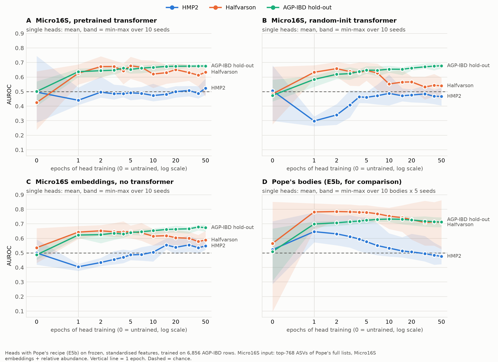

# What makes a microbiome transformer transfer across studies?

Pope et al. (2025, *PLoS Comput Biol* 21(5):e1011353) pretrain an ELECTRA transformer on American Gut Project (AGP) samples, fine-tune it to detect IBD, and report state-of-the-art cross-study performance on two external cohorts (HMP2, Halfvarson). This project asks where that transfer comes from. We rebuilt their pipeline from the released data and models, reproduced the published numbers, and then removed candidate explanations one at a time: the abundance encoding, the token order, what the encoder represents, how the classification head is trained, and pretraining itself. The conclusions were then tested on a second foundation model (Micro16S) and on an unlabelled type 2 diabetes cohort.

*Status: complete (November 2026). Course project for 2110581 (Bioinformatics). The final report and slides are kept outside this repository.*

## Key findings

All cross-study numbers are AUROC for IBD, trained on AGP-IBD (n = 8,571; 5% IBD) and tested without fine-tuning on HMP2 (n = 197) and Halfvarson (n = 564). Bootstrap CIs ignore repeated samples per patient (no subject IDs are distributed), so they are too narrow.

1. **Reproduction.** Pope et al.'s released ensemble gives 0.686 [0.582, 0.774] on HMP2 and 0.830 [0.769, 0.886] on Halfvarson (paper: 0.682 / 0.805).
2. **Abundance encoding is not the source (Phase 0).** With a random forest, rank encoding does not transfer better than relative abundance (HMP2 ΔAUROC −0.049 [−0.103, +0.001]). Changing only `class_weight` moves Halfvarson from 0.82 to 0.34 and reverses the encoding ranking, so classifier settings matter more than encoding.
3. **Token order is not used (E4).** Pope's model sees no counts, only taxa sorted by abundance. Shuffling or reversing that order at test time does not lower AUROC (HMP2 +0.020 [+0.009, +0.033] shuffled, +0.039 [+0.019, +0.062] reversed; Halfvarson unchanged). Keeping only the 64 most abundant taxa helps HMP2 (0.780) but hurts Halfvarson (0.690); 64 random taxa are worse on HMP2, so its signal sits in the dominant taxa.
4. **The encoder mostly encodes where a sample came from (E5).** Linear probes recover the cohort from every layer (selectivity 0.60–0.63, maximum 0.67), equally well in an untrained encoder. Read depth and taxa count alone give 0.51; about 0.50 remains after partialling them out.
5. **Transfer depends on stopping the head early, not on its recipe (E5b).** A fresh linear head on the same features transfers poorly (E4b), while Pope's head recipe does. Training that recipe longer raises in-domain AUROC but lowers HMP2 from 0.653 (1 epoch) to 0.530 (10) and 0.474 (50). Logistic regression with the strongest L2 penalty (C = 1e-4) reaches 0.635 / 0.808, close to Pope's head; a weak penalty (C = 100) drops Halfvarson to 0.31. Swapping parts of the recipe (MLP, MSE, sampler, dropout) changes AUROC by at most 0.042. An untrained encoder shows the same rise-then-fall (HMP2 peak 0.676 vs 0.689 pretrained), so in this setting pretraining mainly makes the peak arrive sooner.
6. **Simple sample statistics explain much of HMP2 (E5c).** Richness and read depth alone reach 0.718 on HMP2 and 0.725 on Halfvarson. Adding the model's score improves HMP2 by +0.025 [−0.021, +0.072] and Halfvarson by +0.123 [+0.059, +0.187].
7. **What helps one cohort hurts the other (E7).** Abundance-weighted pooling of the token states, at epoch 10 (mean over heads): HMP2 0.73 vs 0.61 for plain mean pooling, Halfvarson 0.51 vs 0.68.
8. **The IBD score tracks low diversity in people without IBD (E8).** In 100 type 2 diabetes metagenomes (no IBD, no controls), P(IBD) correlates with richness at ρ −0.31 to −0.47 (CIs exclude 0 for all three read-counting variants). Technical batch (6 sequencing runs) is barely visible in the encoder (selectivity 0.04–0.08) and less than in depth plus richness alone (0.20–0.28).
9. **A second model replicates in part (E9).** With Micro16S (phylogenetic 16S embeddings, abundance as a number), Halfvarson again peaks after 2–5 epochs and then falls, and pretraining changes little. On HMP2 the early heads fall below chance (0.44 pretrained, 0.30 random init), and richness does not explain this.
10. **Transfer tracks how well the disease directions align (E10, exploratory).** In each of 159 feature spaces, the class-mean difference (IBD minus control) learned on AGP, used directly as a classifier, reaches median AUROC 0.700 / 0.746 for Pope's fine-tuned models, against 0.552 / 0.486 for logistic regression at C = 1. Across spaces, its AUROC correlates with the cosine between the AGP direction and the test cohort's own direction (Spearman ρ 0.78 HMP2, 0.74 Halfvarson). In Micro16S the two directions point opposite ways on HMP2 (cos −0.44 to −0.68), matching its below-chance heads. Caveats: the test direction uses test labels (a diagnostic, not a model-selection rule), part of the correlation is expected by construction, the spaces come from a few related models, and 87% (HMP2) and 94% (Halfvarson) of single-space cosines fall inside the 95% range of a label-shuffle null.

## Figures

**Training the head longer helps in-domain but hurts transfer (E5b).** Pope's head recipe on frozen features. In-domain AUROC (green) rises with training while HMP2 (blue) falls below chance. An untrained encoder (D) shows the same rise-then-fall, with a later peak.



**Stronger regularisation, better transfer (E5b).** Logistic regression on the same features. On Pope's bodies (A, B), cross-study AUROC is highest at the strongest penalty and falls below chance as C grows, while in-domain AUROC barely moves.



**Disease-direction alignment tracks transfer (E10).** Each dot is one feature space. With the class-mean-difference classifier (top), AUROC rises with the cosine between the AGP and test-cohort disease directions, and Micro16S on HMP2 (green, left) points the opposite way. With weakly regularised logistic regression (bottom) the relation disappears.



**Token order is not used; token budget cuts both ways (E4).** A: shuffling or reversing the order at test time does not lower AUROC. B: keeping only the K most abundant taxa helps HMP2 and hurts Halfvarson; K random taxa (dashed) are worse on HMP2.



**The encoder knows the cohort, even untrained (E5).** A: cohort identity is decodable from every layer, as well in an untrained encoder. C: a fresh linear head on these features transfers poorly. D: read depth and taxa count can be read back almost fully.



**Scores fall with richness (E5c).** P(IBD) against richness in both test cohorts, for Pope's ensemble and for a random forest (Spearman ρ −0.48 to −0.76).



**A second model replicates in part (E9).** Micro16S heads on Halfvarson peak early and then fall, as with Pope's model (D); on HMP2 they start below chance.



**Encoding comparison (Phase 0).** Random forest with `class_weight = balanced`, five abundance encodings, on the two cross-study cohorts and two in-domain splits (the unweighted run is `fig1b_encoding_comparison_unweighted.png`).


## Experiments

| Step | Question | Scripts (`src/`) | Results |
|---|---|---|---|
| Phase 0 | Does the abundance encoding change transfer? | `data.py`, `encodings.py`, `evaluate.py`, `report.py`, `s2_diagnostics.py` | [`phase0_summary.md`](results/phase0_summary.md) |
| E4 | Does the model use token order? (a: test-time order, b: train × test order, c: order-free baselines, d: top-K taxa) | `pope_model.py`, `e4_harness.py`, `e4b_features.py`, `e4b_head.py`, `e4c_bag.py`, `e4_report.py` | [`e4_summary.md`](results/e4_summary.md) |
| E5 | What does each encoder layer encode? | `e5_states.py`, `e5_probe.py`, `e5_report.py` | [`e5_summary.md`](results/e5_summary.md) |
| E5b | Why does Pope's head transfer when a fresh head does not? | `e5b_head.py`, `e5b_report.py` | [`e5b_summary.md`](results/e5b_summary.md) |
| E5c | How much do richness and depth explain? | `e5c_signal.py`, `e5c_report.py` | [`e5c_summary.md`](results/e5c_summary.md) |
| E7 | Does abundance-weighted pooling help? | `e7_abundance_pool.py` | `e7.csv` |
| E8 | What does the IBD score do in a cohort without IBD? | `e8_metagenome_v4.py`, `e8_t2d_analysis.py`, `e8_progress.py` | `e8.csv` (aggregates only) |
| E9 | Does E5b replicate on Micro16S? | `e9_micro16s_embed.py`, `e9_micro16s_heads.py` | [`e9_summary.md`](results/e9_summary.md) |
| E10 | Does disease-direction alignment predict transfer? | `e10_alignment.py` | [`e10_summary.md`](results/e10_summary.md) |

## Reproduce

```bash
python3 -m venv .venv && source .venv/bin/activate
pip install -r requirements.txt
```

1. **Data.** Download `README.md`, `microbiomedata.zip`, `vocab_embeddings.npy` and `seqs_.07_embed.fasta` from Dryad [doi:10.5061/dryad.tb2rbp08p](https://doi.org/10.5061/dryad.tb2rbp08p) (version 2025-02-20) in a browser (Dryad blocks scripted downloads), then verify them against Dryad's SHA-256 digests and unzip:
   ```bash
   python src/verify_downloads.py --move-from ~/Downloads
   cd data/raw && unzip -q microbiomedata.zip -d microbiomedata/ && cd ../..
   ```
   From E4 on you also need `ensemble.zip` (the 10 fine-tuned models) and `pretrainedmodels.zip` from the same record, unzipped to the paths in `config.yaml` (`data/raw/ensemble/`, `data/raw/pretrainedmodels/`).
2. **Phase 0.** `python src/inspect_data.py` (checks against the paper), `python src/data.py`, `bash results/run_full_grid.sh` (about 1.5 h on 8 CPU cores), then `python src/report.py`.
3. **E4–E10.** Each script's docstring gives its exact commands and stop points. In order:
   ```bash
   python src/e4_harness.py --gate
   python src/e4_harness.py --conditions shuffle ties reverse
   python src/e4_harness.py --conditions top16 top32 top64 top128 top256 top512 rand16 rand32 rand64 rand128 rand256
   python src/e4b_features.py && python src/e4b_head.py && python src/e4c_bag.py && python src/e4_report.py
   python src/e5_states.py && python src/e5_probe.py && python src/e5_report.py
   python src/e5b_head.py --gate && python src/e5b_head.py --configs pope && python src/e5b_head.py --lr && python src/e5b_report.py
   python src/e5c_signal.py --sc 0 && python src/e5c_signal.py --sc 1 2 3 && python src/e5c_report.py
   python src/e7_abundance_pool.py --extract && python src/e7_abundance_pool.py --heads
   python src/e9_micro16s_embed.py && python src/e9_micro16s_heads.py --extract && python src/e9_micro16s_heads.py --heads --lr --report
   python src/e10_alignment.py
   ```
4. **Tests.** `python -m pytest src` (install `pytest` first; `test_encodings.py` also runs under `unittest`).

**E8** needs the diabetes cohort, which is not public and is never stored in this repository. `src/e8_metagenome_v4.py` maps its shotgun reads to Pope's V4 sequences and writes per-sample profiles outside the repo; only the aggregate `results/e8.csv` is committed.

**E9** needs the Micro16S code and checkpoint from the authors' GitHub repositories ([micro16s](https://github.com/HaigBishop/micro16s), [micro16s-transformer](https://github.com/HaigBishop/micro16s-transformer)) in `~/micro16s_work`. They ship no licence, so nothing of theirs is included here; the checkpoint is loaded with `torch.load(weights_only=True)`.

## Layout

```
src/        data, encodings, Pope's model wrapper, one script per experiment, unit tests
results/    per-run CSVs, *_summary.md, predictions (preds/), run logs (logs/)
figures/    Figure 1/1b/2 (Phase 0) and one figure per experiment (fig_e4_*, fig_e5*, fig_e9_*, fig_e10_*)
config.yaml paths and fixed settings shared by the scripts
```

Raw and processed data (about 4 GB), cached encoder features, Pope et al.'s models and the authors' Zenodo code are not included; the steps above recreate them.

## Notes

- Data and pretrained models: Pope et al., Dryad doi:10.5061/dryad.tb2rbp08p. Curated from Tataru & David (2020); raw data from the American Gut Project, Halfvarson et al. (2017) and HMP2.
- Micro16S: Bishop et al. (2026), bioRxiv doi:10.64898/2026.03.21.713432.
- In-domain numbers are upper bounds: random splits of the released AGP-IBD data leak same-patient samples, and the released train/test split is batch-shifted (domain classifier AUROC 0.93). See `results/phase0_summary.md`.
