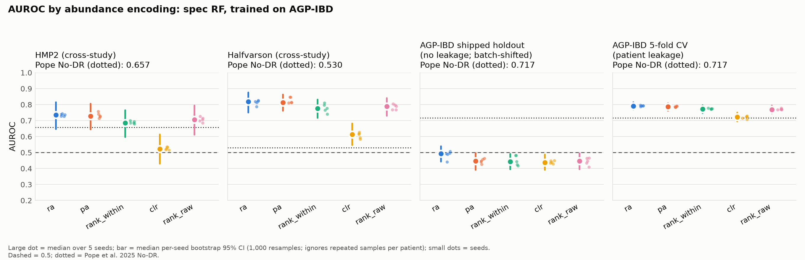

# Rank encoding vs. learned context in microbiome transformers

**Phase 0 — does the way abundance is encoded change cross-study transfer?**

Pope et al. (2025, *PLoS Comput Biol* 21(5):e1011353) report that the ways of injecting abundance into their microbiome transformer showed "little difference", and chose rank ordering for simplicity, without reporting numbers. Phase 0 measures that claim on their own released data and cross-study protocol: one locked vocabulary, one fixed classifier, and only the abundance encoding varies.

*Status: Phase 0 complete (September 2026). Course project for 2110581 (Bioinformatics); next phases probe Pope et al.'s pretrained encoder (shuffle test, layer-wise probing, concept erasure).*

## Key findings

Random forest trained on AGP-IBD (n = 8,571; 5% IBD), tested without fine-tuning on HMP2 (n = 197) and Halfvarson (n = 564). Median AUROC over 5 seeds, [bootstrap 95% CI].

| Encoding | HMP2 | Halfvarson |
|---|---|---|
| relative abundance (`ra`) | **0.736** [0.646, 0.815] | **0.818** [0.751, 0.876] |
| presence–absence | 0.728 [0.645, 0.806] | 0.814 [0.761, 0.863] |
| rank (Geneformer-style) | 0.684 [0.596, 0.765] | 0.776 [0.717, 0.831] |
| rank (raw) | 0.706 [0.612, 0.794] | 0.789 [0.729, 0.841] |
| centred log-ratio | 0.522 [0.431, 0.613] | 0.614 [0.546, 0.682] |

1. **Rank encoding does not transfer better than relative abundance** with a random forest (paired ΔAUROC, rank vs `ra`, HMP2: −0.049 [−0.103, +0.001]).
2. **Classifier configuration matters more than encoding.** Changing only `class_weight` moves Halfvarson AUROC from 0.82 to 0.34 and reverses the encoding ranking (CLR goes from worst to best).
3. **A fairly configured RF matches Pope et al.'s transformer cross-study** (0.736 / 0.818 vs 0.682 / 0.805; CIs overlap).
4. **In-domain evaluation is compromised in the released data.** Random splits leak same-patient samples (IBD nearest-neighbour enrichment 6.3× over base rate), and the released train/test split is batch-shifted (domain classifier AUROC 0.93). No patient IDs are distributed.



Full numbers: [`results/phase0_summary.md`](results/phase0_summary.md) 
## Reproduce

```bash
python3 -m venv .venv && source .venv/bin/activate
pip install -r requirements.txt
```

1. **Data.** Download `README.md`, `microbiomedata.zip`, `vocab_embeddings.npy` and `seqs_.07_embed.fasta` from Dryad [doi:10.5061/dryad.tb2rbp08p](https://doi.org/10.5061/dryad.tb2rbp08p) (version 2025-02-20) in a browser (Dryad blocks scripted downloads), then verify them against Dryad's SHA-256 digests and unzip:
   ```bash
   python src/verify_downloads.py --move-from ~/Downloads
   cd data/raw && unzip -q microbiomedata.zip -d microbiomedata/ && cd ../..
   ```
2. **Inspect and build.** `python src/inspect_data.py` (checks against the paper), then `python src/data.py`.
3. **Test.** `python -m unittest src/test_encodings.py -v`
4. **Run.** `bash results/run_full_grid.sh` (about 1.5 h for the primary arm on 8 CPU cores), then `python src/report.py`.

Optional: `src/s2_diagnostics.py` (why the baseline differs from the paper) and `src/s3_pretrained_check.py` (needs `pretrainedmodels.zip` from the same Dryad record).

## Layout

```
src/        data loading, encodings (+ unit tests), evaluation, diagnostics, figures
results/    per-run CSV (every run, including diagnostics), predictions, logs, summary
figures/    Figure 1, 1b, 2
```

Raw and processed data (≈4 GB) and the authors' Zenodo code are not included; the steps above recreate them.

## Notes

- Data and pretrained models: Pope et al., Dryad doi:10.5061/dryad.tb2rbp08p. Curated from Tataru & David (2020); raw data from the American Gut Project, Halfvarson et al. (2017) and HMP2.
